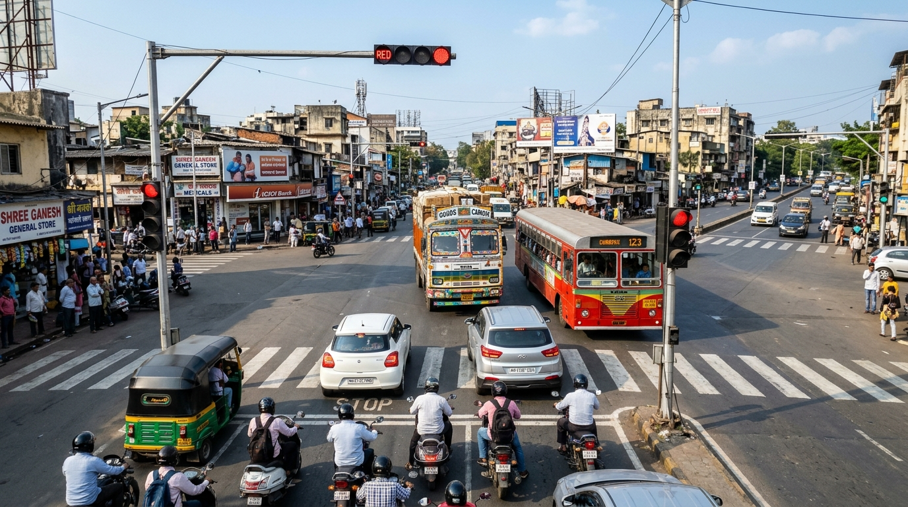

# VisionPort – Intelligent Vehicle Detection and Traffic Monitoring Using Deep Learning

<p align="center">
  
</p>

<p align="center">
  
  
  
  
  
</p>

---

## 📌 Project Information

| Field | Detail |
|-------|--------|
| **Project Name** | VisionPort |
| **Project Title** | Intelligent Vehicle Detection and Traffic Monitoring Using Deep Learning |
| **Main Model Name** | `traffic_detector` |
| **Architecture** | YOLOv8 · OpenCV · FastAPI |
| **Language** | Python 3.12 |
| **Framework** | Ultralytics YOLOv8n (COCO pre-trained) |

---

## 🚦 Overview

**VisionPort** is a complete end-to-end intelligent traffic monitoring and vehicle detection system built using deep learning and computer vision. The system is capable of:

- 🚗 Detecting multiple vehicle categories (cars, motorcycles, buses, trucks)
- 📊 Real-time vehicle counting with spatial deduplication
- 🌡️ Traffic density classification (LOW / MEDIUM / HIGH)
- 🚨 Persistent congestion detection at junctions
- 🔎 Vehicle tracking with unique IDs across frames
- ⚡ Approximate vehicle speed estimation
- 🚦 Traffic signal status detection (RED / YELLOW / GREEN)
- ⏱️ Traffic waiting time estimation
- 🔄 Junction entry & exit counting
- 🚫 Wrong-turn and wrong-way vehicle detection
- 🅿️ Illegal parking detection in restricted zones
- 👥 Triple-riding detection on two-wheelers

---

## 📁 Project Folder Structure

```
VisionPort/
├── .gitignore
├── README.md                               # Project documentation (this file)
├── requirements.txt                        # All Python dependencies
├── pyproject.toml                          # Project metadata
├── run_visionport.bat                      # One-click Windows launcher
├── run_all_tasks.py                        # Master automated task runner (Tasks 1–20)
│
├── vehicle_detector.py                     # Core engine – TrafficDetector class
├── visionport.py                           # FastAPI server – all REST endpoints
├── visionport.html                         # Interactive web portal dashboard (Tasks 1–20 UI)
│
├── sample_traffic.jpg                      # Reference traffic junction image
├── traffic_sample.mp4                      # Reference traffic video stream
├── yolov8n.pt                              # YOLOv8 neural network weights
│
├── task1_setup_and_verify.py               # Task 1  : Environment & library verification
├── task2_capture_traffic_signal.py         # Task 2  : Webcam traffic image capture
├── task3_read_display_traffic_image.py     # Task 3  : Read & display images with OpenCV
├── task4_load_play_traffic_video.py        # Task 4  : Video playback (pause/resume/exit)
├── task5_extract_video_frames.py           # Task 5  : Frame extraction to files
├── task6_detect_cars.py                    # Task 6  : Car detection (YOLO + bounding boxes)
├── task7_detect_multiple_vehicles.py       # Task 7  : Multi-class detection (car/bike/bus/truck)
├── task8_display_labels_confidence.py      # Task 8  : Labels & confidence scores on detections
├── task9_count_vehicles.py                 # Task 9  : Per-frame vehicle counting (deduplicated)
├── task10_traffic_density.py               # Task 10 : LOW / MEDIUM / HIGH density classifier
├── task11_traffic_congestion.py            # Task 11 : Multi-frame congestion alert system
├── task12_track_vehicles.py                # Task 12 : Vehicle tracking with unique IDs & trails
├── task13_speed_estimation.py              # Task 13 : Approximate vehicle speed estimation
├── task14_traffic_signal_status.py         # Task 14 : Signal status detection (RED/YELLOW/GREEN)
├── task15_traffic_waiting_time.py          # Task 15 : Waiting-time estimation report
├── task16_junction_entry_exit.py           # Task 16 : Entry & exit vehicle count at junction
├── task17_wrong_turn_detection.py          # Task 17 : Wrong-turn detection at intersections
├── task18_wrong_way_detection.py           # Task 18 : Wrong-way vehicle alerts
├── task19_illegal_parking.py               # Task 19 : Illegal parking detection in restricted zones
├── task20_triple_riding_detection.py       # Task 20 : Triple-riding detection on two-wheelers
│
├── task1_opencv_test.jpg                   # Output: Task 1
├── task3_display_output.jpg                # Output: Task 3
├── task6_car_detection_output.jpg          # Output: Task 6
├── task7_multiple_vehicles_output.jpg      # Output: Task 7
├── task8_labels_confidence_output.jpg      # Output: Task 8
├── task9_vehicle_count_output.jpg          # Output: Task 9
├── task10_traffic_density_output.jpg       # Output: Task 10
├── task11_congestion_alert_output.jpg      # Output: Task 11
├── task12_vehicle_tracking_output.jpg      # Output: Task 12
├── task13_speed_estimation_output.jpg      # Output: Task 13
├── task14_signal_status_output.jpg         # Output: Task 14
├── task15_waiting_time_output.jpg          # Output: Task 15
├── task15_waiting_time_report.json         # Output: Task 15 (JSON report)
├── captured_images/
│   └── captured_traffic_signal.jpg         # Output: Task 2
└── extracted_frames/
    ├── frame_0001.jpg                       # Output: Task 5
    └── ...
```

---

## 📋 Completed Tasks (1 – 20)

### Phase 1 – Environment and Image Processing

| Task # | Task Description | Expected Output | Script | Status |
|:------:|:-----------------|:----------------|:-------|:------:|
| **1** | Install Python, OpenCV and required libraries | Working Python environment | `task1_setup_and_verify.py` | ✅ |
| **2** | Capture an image of a traffic signal using a camera | Traffic image capture | `task2_capture_traffic_signal.py` | ✅ |
| **3** | Read and display traffic images using OpenCV | Image display window | `task3_read_display_traffic_image.py` | ✅ |
| **4** | Load and play a traffic video using OpenCV | Video playback | `task4_load_play_traffic_video.py` | ✅ |
| **5** | Extract individual frames from traffic videos | Frames saved as images | `task5_extract_video_frames.py` | ✅ |

### Phase 2 – Vehicle Detection Using YOLO

| Task # | Task Description | Expected Output | Script | Status |
|:------:|:-----------------|:----------------|:-------|:------:|
| **6** | Detect cars in a traffic video using YOLO | Car detection with bounding boxes | `task6_detect_cars.py` | ✅ |
| **7** | Detect bikes, buses and trucks | Multiple vehicle detection | `task7_detect_multiple_vehicles.py` | ✅ |
| **8** | Display vehicle names and confidence scores | Labelled detection output | `task8_display_labels_confidence.py` | ✅ |

### Phase 3 – Traffic Analysis

| Task # | Task Description | Expected Output | Script | Status |
|:------:|:-----------------|:----------------|:-------|:------:|
| **9** | Count the number of vehicles in a video frame | Vehicle count | `task9_count_vehicles.py` | ✅ |
| **10** | Calculate traffic density based on vehicle count | Low / Medium / High traffic | `task10_traffic_density.py` | ✅ |
| **11** | Detect traffic congestion at signal junctions | Congestion alerts | `task11_traffic_congestion.py` | ✅ |

### Phase 4 – Tracking and Advanced Analysis

| Task # | Task Description | Expected Output | Script | Status |
|:------:|:-----------------|:----------------|:-------|:------:|
| **12** | Track individual vehicles across video frames | Vehicle tracking IDs | `task12_track_vehicles.py` | ✅ |
| **13** | Calculate approximate vehicle speed | Speed estimation | `task13_speed_estimation.py` | ✅ |
| **14** | Identify traffic signal status (red, yellow, green) | Signal status detection | `task14_traffic_signal_status.py` | ✅ |
| **15** | Estimate traffic waiting time | Waiting-time report | `task15_traffic_waiting_time.py` | ✅ |

### Phase 5 – Advanced Traffic Management

| Task # | Task Description | Expected Output | Script | Status |
|:------:|:-----------------|:----------------|:-------|:------:|
| **16** | Count vehicles entering and leaving a junction | Entry and exit vehicle count | `task16_junction_entry_exit.py` | ✅ |
| **17** | Detect vehicles making wrong turns at intersections | Wrong-turn detection | `task17_wrong_turn_detection.py` | ✅ |
| **18** | Identify vehicles moving in the wrong direction | Wrong-way vehicle alerts | `task18_wrong_way_detection.py` | ✅ |
| **19** | Detect vehicles parked in restricted traffic areas | Illegal parking detection | `task19_illegal_parking.py` | ✅ |
| **20** | Detect two-wheelers carrying more than two persons | Triple-riding detection | `task20_triple_riding_detection.py` | ✅ |

---

## 🛠️ Required Dependencies

All packages are listed in `requirements.txt`. Install using:

```powershell
pip install -r requirements.txt
```

| Package | Version | Purpose |
|---------|---------|---------|
| `opencv-python` | ≥ 4.8.0 | Image & video processing |
| `numpy` | ≥ 1.24.0 | Array operations |
| `pillow` | ≥ 10.0.0 | Image I/O |
| `torch` | ≥ 2.0.0 | Deep learning backend |
| `torchvision` | ≥ 0.15.0 | Vision model utilities |
| `ultralytics` | ≥ 8.0.0 | YOLOv8 model |
| `fastapi` | ≥ 0.100.0 | REST API server |
| `uvicorn` | ≥ 0.20.0 | ASGI web server |
| `python-multipart` | ≥ 0.0.6 | File upload support |
| `matplotlib` | ≥ 3.7.0 | Visualisation utilities |

---

## 🚀 How to Run

### 1. Run any individual task script directly

```powershell
cd "B:\Deep learning\VisionPort"
python task1_setup_and_verify.py
python task6_detect_cars.py
python task11_traffic_congestion.py
# ... (same pattern for tasks 1–20)
```

### 2. Run all 20 tasks in one command

```powershell
python run_all_tasks.py
```

### 3. Launch the VisionPort Live Web Dashboard

```powershell
python visionport.py
```

Then open **[http://localhost:8000](http://localhost:8000)** in any browser.

> The portal shows **20 task buttons**. Click any task to run it and see its output image directly in the browser. Upload your own traffic image to test live detection.

---

## 🌐 REST API Endpoints

| Method | Endpoint | Description |
|--------|----------|-------------|
| `GET` | `/` | Interactive web portal (HTML dashboard) |
| `GET` | `/status` | System health, model info, all capabilities |
| `GET` | `/tasks` | List all 20 tasks (IDs, scripts, output files) |
| `POST` | `/run/{task_id}` | Run any task 1–20; returns output image |
| `POST` | `/detect/` | Real-time detection; returns annotated image + JSON headers |
| `POST` | `/analyze/` | Full JSON analysis (counts, density, signal, tracking, waiting time) |
| `GET` | `/{filename}` | Serve any output image or video from the project directory |

### Example API Usage

```bash
# Run Task 11 (Congestion Detection) via API
curl -X POST http://localhost:8000/run/11 --output task11_result.jpg

# Run live detection with your own image
curl -X POST http://localhost:8000/detect/ \
  -F "file=@my_traffic_image.jpg" \
  --output detection_result.jpg

# Get full JSON analysis
curl -X POST http://localhost:8000/analyze/ \
  -F "file=@my_traffic_image.jpg"
```

---

## 🏗️ System Architecture

```
                    ┌─────────────────────────────────┐
                    │      visionport.html             │
                    │  (Interactive Web Dashboard)     │
                    │  20 Task Buttons + Live Detect   │
                    └───────────┬─────────────────────┘
                                │  HTTP POST / GET
                    ┌───────────▼─────────────────────┐
                    │      visionport.py               │
                    │  (FastAPI REST Server)           │
                    │  /run/{id} /detect/ /analyze/   │
                    └───────────┬─────────────────────┘
                                │
                    ┌───────────▼─────────────────────┐
                    │    vehicle_detector.py           │
                    │   (TrafficDetector Class)        │
                    │                                 │
                    │  ┌─────────────────────────┐   │
                    │  │  YOLOv8n (yolov8n.pt)   │   │
                    │  │  traffic_detector model  │   │
                    │  └─────────────────────────┘   │
                    │                                 │
                    │  detect_multiple_vehicles()     │
                    │  count_vehicles()               │
                    │  get_density()                  │
                    │  check_congestion()             │
                    │  track_vehicles()               │
                    │  estimate_speed()               │
                    │  detect_traffic_signal()        │
                    │  estimate_waiting_time()        │
                    └─────────────────────────────────┘
```

---

## 📊 Sample Output Screenshots

| Task | Output |
|------|--------|
| Task 6 – Car Detection | Bounding boxes drawn around each detected car |
| Task 9 – Vehicle Count | Total vehicle count overlaid on frame |
| Task 10 – Density | Traffic density badge (LOW/MEDIUM/HIGH) |
| Task 11 – Congestion | Red alert banner when congestion persists |
| Task 12 – Tracking | Unique ID labels with motion trails |
| Task 14 – Signal | Signal lamp colour detection (RED/YELLOW/GREEN) |
| Task 16 – Entry/Exit | Virtual line counter at junction |
| Task 20 – Triple-Riding | Motorcycle highlighted with person count |

---

## 👩‍💻 Author

**Student:** Ruhitha  
**Repository:** [2520080053-Deep_learning](https://github.com/ruhitha007/2520080053-Deep_learning)  
**Project:** VisionPort — Deep Learning Lab Project  

---

## 📄 License

This project is submitted as an academic deep learning lab assignment.  
All YOLOv8 weights are provided by [Ultralytics](https://github.com/ultralytics/ultralytics) under the AGPL-3.0 license.
